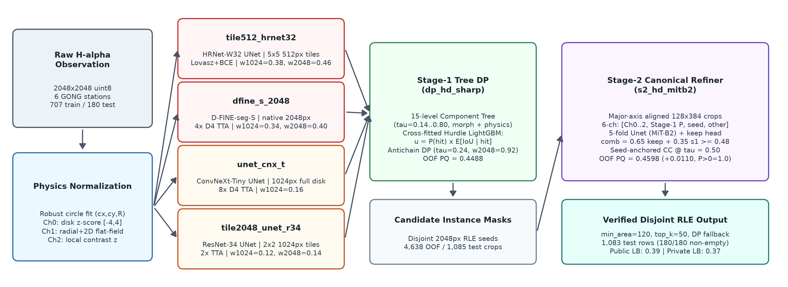
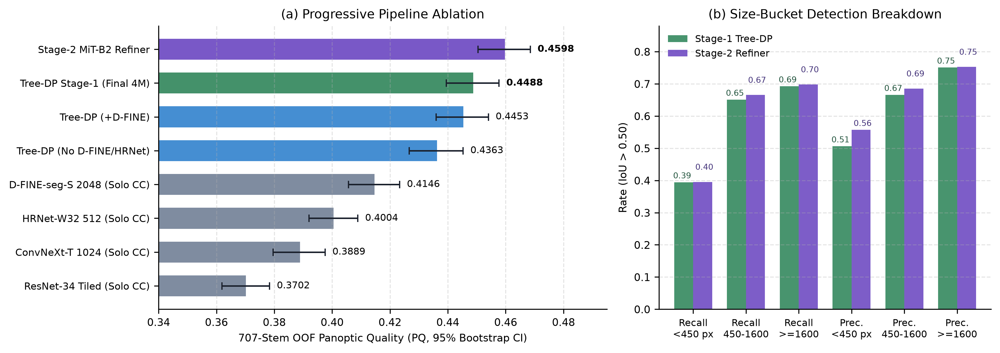
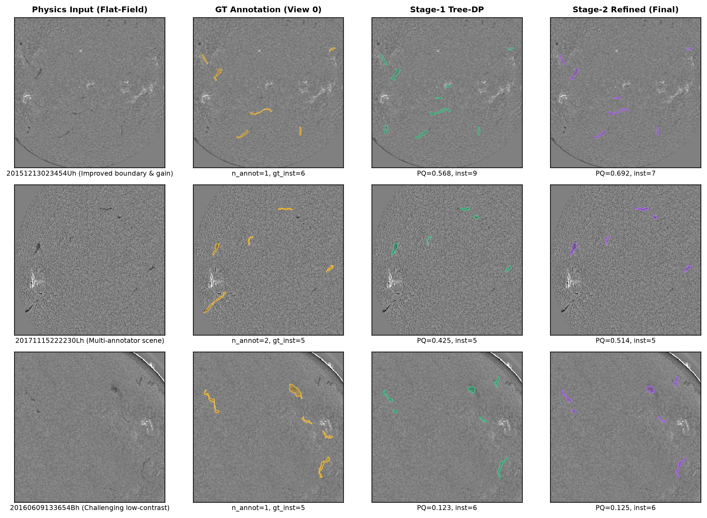

# Solar Filament Segmentation Challenge 2026

Code, trained model configuration, and end-to-end reproduction pipeline for our final evaluated Kaggle submission (`s2_hd_mitb2_d3_2.csv`, submission ref `58424451`) in the **Solar Filament Segmentation Challenge 2026** (MAGFiLO 1.0 H-alpha dataset).

We are not pretending a 0.37 Private LB solved solar physics — turns out thin dark threads across six ground-based telescopes with clouds, limb darkening, and multi-annotator disagreement will keep you humble. What this repo *does* give you is a clean, deterministic pipeline that reproduces our exact submitted predictions without needing hidden notebooks or mystery files.

## Summary & Results

All validation metrics below are measured on the full **707-stem** canonical 5-fold `StratifiedGroupKFold` (`station x multiplicity`, evaluating all **1,154** annotator views / **8,199** ground-truth instances at `2048x2048` Panoptic Quality).

| Stage / Model | Resolution / Tiling | 707-Stem OOF PQ (95% Bootstrap CI) | SQ | RQ | TP / FP / FN | Public / Private LB |
|---|---|---:|---:|---:|---:|---|
| ResNet-34 U-Net (solo CC) | 2x2 1024px tiles -> 2048px | 0.3702 [0.3619, 0.3784] | 0.6684 | 0.5538 | 5561 / 6322 / 2638 | - |
| ConvNeXt-Tiny U-Net (solo CC) | 1024px full disk | 0.3889 [0.3796, 0.3976] | 0.6632 | 0.5864 | 5260 / 4480 / 2939 | - |
| HRNet-W32 U-Net (solo CC) | 5x5 512px tiles + Lovasz | 0.4004 [0.3920, 0.4089] | 0.6762 | 0.5922 | 5799 / 5587 / 2400 | - |
| D-FINE-seg-S (solo CC) | 2048px native | 0.4146 [0.4057, 0.4234] | 0.6744 | 0.6148 | 5247 / 3624 / 2952 | - |
| **Stage-1 Tree DP (`dp_hd_sharp`)** | 4-model ensemble + Hurdle LGBM DAG | **0.4488** [0.4394, 0.4577] | 0.6791 | 0.6609 | 5210 / 2357 / 2989 | - |
| **Stage-2 Crop Refiner (`s2_hd_mitb2`, final)** | Canonical 128x384 6-ch Unet (MiT-B2) | **0.4598** [0.4504, 0.4685] | 0.6841 | 0.6721 | 5277 / 2227 / 2922 | **0.39 / 0.37** (`58424451`) |



## Architecture Overview

1. **Solar Disk Geometry & Physics Normalization (`src/geometry.py`, `src/cache.py`, `src/cache_2048.py`)**
   - Iteratively fits the solar disk circle `(cx, cy, R)` via robust MAD outlier rejection.
   - Builds a 3-channel normalized input at both `1024x1024` and `2048x2048`:
     - Channel 0: global disk z-score clipped to `[-4, 4]`.
     - Channel 1: radial median limb-darkening flat-field + 2-pass robust 2D cloud/vignetting background leveling.
     - Channel 2: multi-scale local contrast z-score.

2. **Stage-1 Heterogeneous 5-Fold Models**
   - **`tile512_hrnet32`** (`src/train_tile512.py`): `Unet(tu-hrnet_w32)` trained on 512x512 crops with calibrated foreground weighting and late Lovasz-hinge fine-tuning; 5x5 Hanning-blended 4x D4 TTA inference at `2048x2048`.
   - **`dfine_s_2048`** (`src/train_dfine.py`): `dfine-seg` Small semantic segmentation trained natively at `2048x2048` on individual annotator views with 4x D4 TTA.
   - **`unet_cnx_t`** (`src/train_seg.py`): `Unet(tu-convnext_tiny)` full-disk `1024x1024` multi-task segmentation + spine head with 8x D4 TTA.
   - **`tile2048_unet_r34`** (`src/train_tile2048.py`): `Unet(resnet34)` on 1024x1024 tiles with 2x2 sliding Hanning inference (2x TTA) at `2048x2048`.

3. **Component Tree + Hurdle LightGBM + Antichain DP (`src/tree_dp.py`, `src/run_tree_dp.py`)**
   - Blends Stage-1 probabilities at `1024px` (`[0.38, 0.34, 0.16, 0.12]`) and `2048px` (`[0.46, 0.40, 0.14]` across the three native-2048 models, `w_2048 = 0.92`).
   - Sweeps 15 probability thresholds (`0.14..0.80`) into a nested parent-child Component Tree (~102k nodes on OOF) annotated with morphology, distance-transform thickness, solar radius, spine density, and cross-model variance features.
   - A 5-fold cross-fitted Hurdle LightGBM scores expected PQ utility `u = P(hit) * E[IoU | hit]`, and exact Dynamic Programming picks the optimal disjoint antichain per image (`tau = 0.24`).

4. **Stage-2 Canonical Rotated Crop Refiner (`src/stage2_refine.py`)**
   - Rotates each candidate filament into its principal-axis frame (`128x384`, 6 channels: 3 physics channels + Stage-1 probability + target seed mask + neighbor exclusions) so a `Unet(mit_b2)` refiner sees filaments horizontally centered at canonical scale regardless of orientation or aspect ratio.
   - Predicts both refined binary mask logits and an instance-pooled existence probability (`keep`).
   - Final filtering keeps instances with `0.65 * keep + 0.35 * s1_score >= 0.48`, extracts connected masks seeded by the dilated Stage-1 proposal at `tau = 0.50`, enforces disjoint 2048px RLE encoding (`min_area = 120`, `top_k = 50`), and falls back to `dp_hd_sharp` only on empty images (`0/180` triggered on test).



## Qualitative Examples

Side-by-side 2048px OOF crops showing normalized flat-field input, annotator ground truth, Stage-1 Tree-DP candidates (`dp_hd_sharp`), and Stage-2 canonical refinement (`s2_hd_mitb2`), including a low-contrast limb region where broken segments remain challenging.



## Quick Reproduction

### 1. Environment Setup

```bash
python -m venv .venv
source .venv/bin/activate
pip install -r requirements.txt
```

### 2. Place Dataset

Put the Kaggle competition archive contents at `data/MAGFiLO_1.0_Kaggle_2026/` (or pass `--data-root /path/to/MAGFiLO_1.0_Kaggle_2026`):

```text
data/MAGFiLO_1.0_Kaggle_2026/
  train/
    MAGFiLO_1.0_Annotations_kaggle2026_train.json
    train_images/*.jpeg
  test/
    test_images/*.jpeg
```

### 3. Download Checkpoints & Reproduce `submission.csv`

`reproduce_submission.py` automatically downloads and SHA-256 verifies all 5-fold Stage-1, Tree-DP (`dp_hd_sharp`), and Stage-2 (`s2_hd_mitb2`) weights from GitHub Release `v1.0` (~2.3 GiB across three archives), computes test normalization caches, runs inference across all models, and writes a verified `submission.csv`:

```bash
python reproduce_submission.py --data-root data/MAGFiLO_1.0_Kaggle_2026 --out-csv submission.csv
```

Or step through the full workflow interactively via **`pipeline.ipynb`**.

## Training from Scratch

To retrain every component end-to-end from raw training images before running inference:

```bash
# 1. Build normalized 1024px & 2048px caches
python -m src.cache
python -m src.cache_2048

# 2. Train Stage-1 5-fold models
python -m src.train_seg --arch Unet --encoder tu-convnext_tiny --run-name unet_cnx_t --folds 0,1,2,3,4 --epochs 24 --batch-size 4 --lr 3e-4 --n-tta 8 --channels-last
python -m src.train_tile2048 --arch Unet --encoder resnet34 --run-name tile2048_unet_r34 --folds 0,1,2,3,4 --epochs 24 --batch-size 4 --lr 4e-4 --n-tta 2
python -m src.train_tile512 --arch Unet --encoder tu-hrnet_w32 --run-name tile512_hrnet32 --folds 0,1,2,3,4 --epochs 20 --crop-size 512 --overlap 0.25 --pos-weight 2.0 --lovasz-weight 0.35 --n-tta 4 --no-arch
python -m src.train_dfine --mode train --run-name dfine_s_2048 --folds 0,1,2,3,4 --epochs 30 --tta 4

# 3. Fit Tree-DP + Hurdle LightGBM aggregator
python -m src.run_tree_dp \
  --runs tile512_hrnet32,dfine_s_2048,unet_cnx_t,tile2048_unet_r34 \
  --weights 0.38,0.34,0.16,0.12 \
  --tile2048-run tile512_hrnet32,dfine_s_2048,tile2048_unet_r34 \
  --tile2048-weights 0.46,0.40,0.14 \
  --w-2048 0.92 --weighted-records --export-sub --out-name dp_hd_sharp

# 4. Train Stage-2 canonical crop refiner & export final submission
python -m src.stage2_refine \
  --dp-name dp_hd_sharp --out-name s2_hd_mitb2 \
  --arch Unet --encoder mit_b2 --folds 0,1,2,3,4 \
  --epochs 16 --batch-size 24 --lr 4e-4 --n-tta 4 --export-sub
```

## Repository Structure

```text
.
├── configs/
│   ├── dfine_sem_seg.yaml        # D-FINE-seg-S 2048px semantic segmentation config
│   └── weights_manifest.json     # SHA-256 manifest for Release v1.0 checkpoints
├── scripts/
│   └── download_weights.py       # Verified downloader/extractor for Release v1.0 weights
├── src/
│   ├── paths.py                  # Repo-relative & env-configurable path resolution
│   ├── geometry.py               # Solar disk fitting + radial/2D flat-fielding
│   ├── data.py                   # Grouped COCO loader & StratifiedGroupKFold splits
│   ├── cache.py / cache_2048.py  # Multi-process 1024px & 2048px feature caching
│   ├── train_seg.py              # Full-disk 1024px ConvNeXt-Tiny trainer/inferencer
│   ├── train_tile2048.py         # 1024px tiled ResNet-34 2048px trainer/inferencer
│   ├── train_tile512.py          # 512px overlapping-tile HRNet-W32 + Lovasz trainer
│   ├── train_dfine.py            # 5-fold D-FINE-seg-S wrapper & 4-TTA exporter
│   ├── tree_dp.py / run_tree_dp.py # Component Tree + Hurdle LightGBM + Antichain DP
│   ├── stage2_refine.py          # Canonical rotated 128x384 Stage-2 crop refiner
│   ├── metrics.py / export.py    # Exact 2048px Panoptic Quality & disjoint RLE I/O
│   └── eval_oof_breakdown.py     # Multiplicity & filament-area PQ diagnostics
├── reproduce_submission.py       # Single-command end-to-end submission reproducer
├── pipeline.ipynb                # Full end-to-end interactive Jupyter notebook
├── requirements.txt              # Pinned Python dependencies
└── assets/                       # Report/README pipeline and evaluation plots
```
